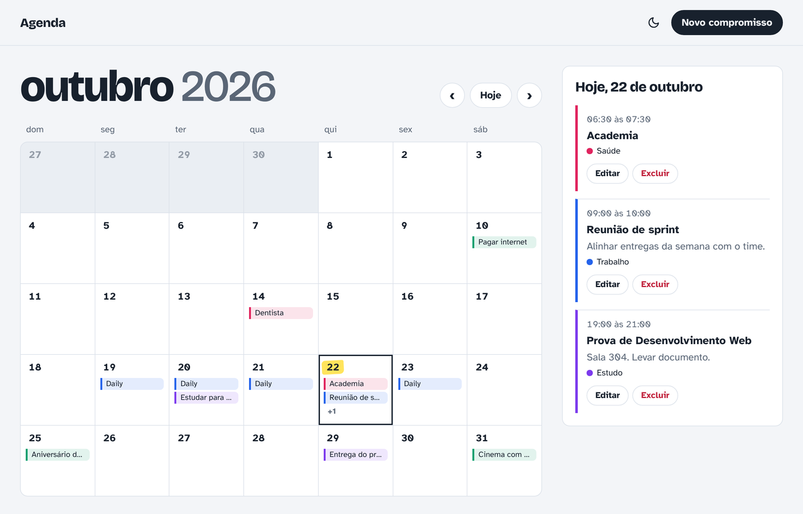
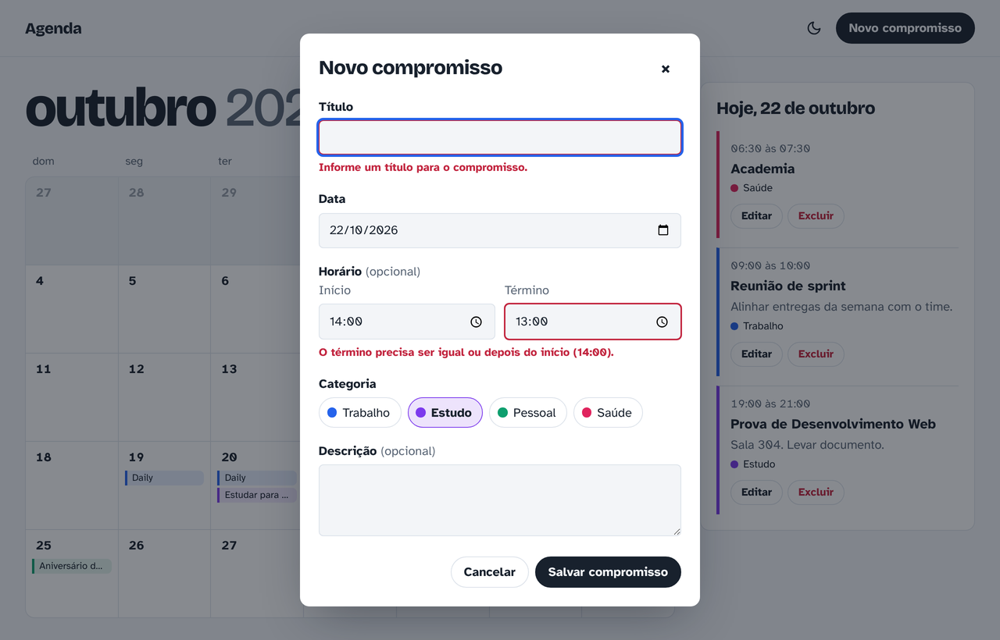
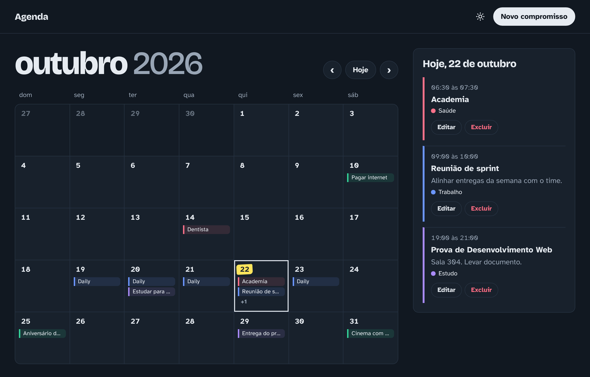
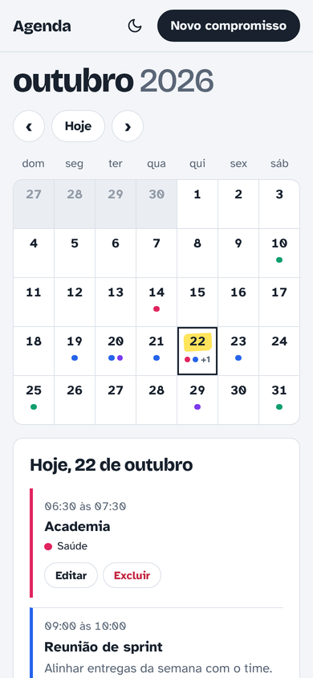
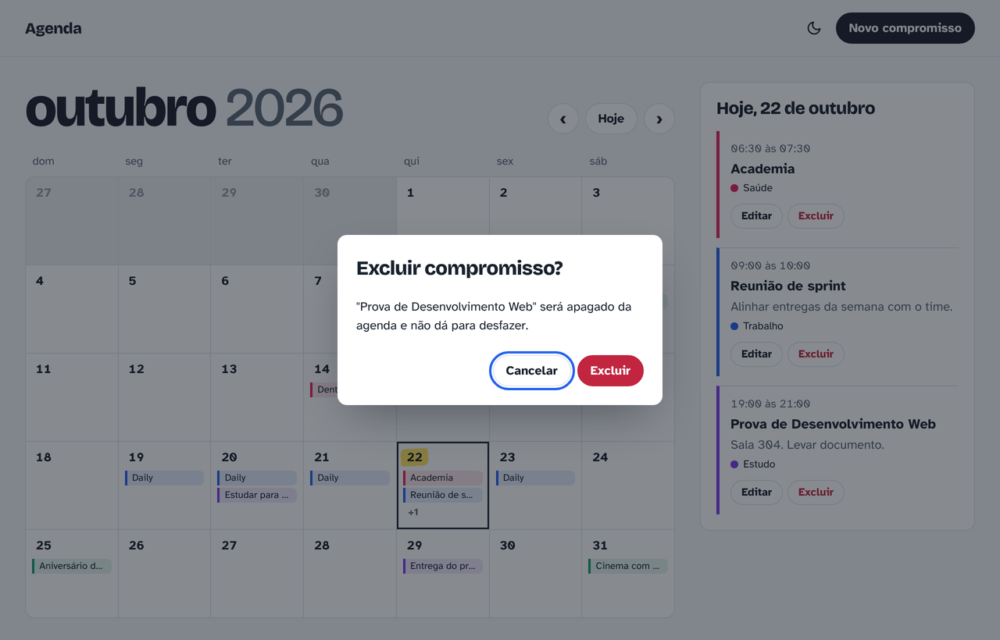

# Agenda de Compromissos

Agenda com calendário mensal feita em HTML, CSS e JavaScript puro, sem framework e sem back-end. Os compromissos ficam salvos no próprio navegador com `localStorage`, então continuam lá depois de recarregar a página.

Projeto individual da disciplina de Desenvolvimento Web do curso de Análise e Desenvolvimento de Sistemas (UniC).

Versão online: https://ismaelbrandao.github.io/agenda-de-compromissos/



## Funcionalidades

- Calendário em grade de domingo a sábado, com nome do mês e ano no topo
- Botões para ir ao mês anterior, ao próximo e voltar para hoje
- O dia de hoje aparece com um destaque amarelo de marca-texto
- Dias com compromissos mostram o título dos dois primeiros e um contador do restante (no celular viram bolinhas na cor da categoria)
- Clicar num dia lista os compromissos dele no painel ao lado, ordenados pelo horário de início
- Cadastro com título, data, início, término, descrição e categoria (trabalho, estudo, pessoal ou saúde, cada uma com sua cor)
- Edição com o formulário já preenchido e exclusão com janela de confirmação
- Tema claro e escuro, seguindo o sistema até a pessoa escolher um

As validações aparecem embaixo de cada campo, sem `alert()`: título e data são obrigatórios, o término não pode ser antes do início e o término só pode ser preenchido junto com o início.



## Como rodar

O JavaScript usa módulos (`import` e `export`). O navegador bloqueia módulos quando o `index.html` é aberto direto pelo explorador de arquivos (endereço começando com `file://`), então a página precisa ser servida por um servidor local. Qualquer uma destas opções funciona:

- Extensão Live Server do VS Code: clique com o botão direito no `index.html` e escolha "Open with Live Server"
- Com Node instalado: `npx serve .` na pasta do projeto
- Com Python instalado: `python -m http.server 8000` e depois abrir http://localhost:8000

## Estrutura

```
index.html                HTML da página e das janelas de formulário e confirmação
css/style.css             estilos, temas claro e escuro e media queries
js/app.js                 estado da tela e ligação entre interface e regras
js/datas.js               regras de calendário (bissexto, dias do mês, grade)
js/compromissos.js        validação, cadastro, edição, exclusão e agrupamento por dia
js/categorias.js          lista de categorias
js/armazenamento.js       leitura e gravação no localStorage
js/ui/calendario.js       desenha a grade do mês
js/ui/painelDia.js        desenha a lista do dia selecionado
js/ui/formulario.js       abre o formulário, preenche e mostra os erros
js/ui/confirmacao.js      janela de confirmação no lugar do confirm()
js/ui/aviso.js            mensagem rápida depois de salvar ou excluir
js/ui/tema.js             troca entre tema claro e escuro
js/ui/dom.js              função auxiliar para criar elementos
```

A separação segue três camadas. `datas.js`, `compromissos.js` e `armazenamento.js` não mexem no DOM. Os arquivos de `js/ui/` só desenham e capturam cliques. O `app.js` junta as duas partes. Como tudo é módulo ES, nenhuma variável fica solta no escopo global.

## Decisões técnicas

### Datas e fuso horário

As datas são guardadas como texto `AAAA-MM-DD`. Ler esse texto com `new Date("2026-10-22")` faz o JavaScript tratar a data como meia-noite em UTC, e em Fortaleza (UTC-3) ela vira 21h do dia anterior. Por isso o código sempre monta a data com `new Date(ano, mes, dia)`, que usa o horário local.

### Ano bissexto

`ehAnoBissexto` aplica a regra completa: divisível por 4, menos os anos de virada de século que não são divisíveis por 400. Fevereiro de 2028 tem 29 dias, e 2100 não é bissexto.

### Primeiro dia da semana

`new Date(ano, mes, 1).getDay()` diz em qual coluna o dia 1 começa. A grade completa as semanas com dias do mês anterior e do seguinte, que aparecem apagados e levam para aquele mês quando clicados.

### Formato salvo

Tudo fica na chave `agenda:compromissos` como um array em JSON:

```json
[
  {
    "id": "mgz3k1x2-a8f2c1",
    "titulo": "Prova de Desenvolvimento Web",
    "data": "2026-10-22",
    "inicio": "19:00",
    "fim": "21:00",
    "descricao": "Sala 304",
    "categoria": "estudo"
  }
]
```

Se o JSON estiver corrompido, a agenda abre vazia em vez de quebrar a página.

### Tema

As cores usam a função `light-dark()` do CSS, então cada cor é declarada uma vez só com as duas versões. A escolha feita no botão fica salva em `agenda:tema`.

## Capturas

| Tema escuro | Celular |
| --- | --- |
|  |  |



## Autor

Ismael Brandão
